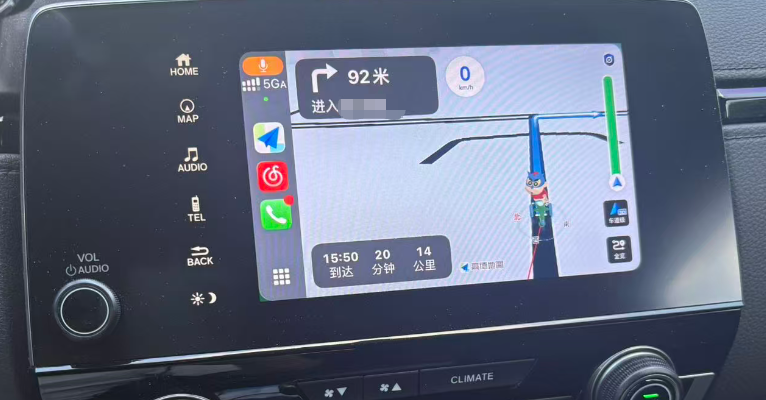

# CarPlay-CRV

[简体中文](#简体中文) | [English](#english)

## 简体中文

基于 [DiPlay](https://github.com/shihabal3amri/DiPlay) 开发，面向 **2021 Honda CR-V** 的 CarPlay 适配项目，优先实现有线 CarPlay。

**适配环境**
- 车机：Android **4.2.2 / API 17** (`minSdk=17`)
- 包名：`com.shihab.diplay`
- 模块：USB、USBMUX、Lockdown、iAP2/MFi、CDC-NCM、AirPlay、音视频与触控

> **车机实测正常：** 已在 2021 款 CR-V 实车验证有线 CarPlay 连接，导航画面正常显示。当前重点优化 CarPlay 流畅度，包括视频解码、缓冲策略、音视频同步和长时间稳定性。



## 当前优化重点

当前主要问题：**CarPlay 流畅度优化**。

优化方向：
- 视频接收与解码性能优化；
- MediaCodec 稳定性优化；
- 降低画面延迟和卡顿；
- 音视频线程调度与缓冲优化；
- 长时间运行稳定性测试。

## 构建与下载

**请先下载源码到本地，再进行本地构建。**

由于 CarPlay MFi 认证需要本地合法配置文件，公开仓库不会上传 MFi 私钥、证书或认证文件。

构建流程：

```bash
git clone https://github.com/lylechencm-xh/CarPlay-CRV.git
cd CarPlay-CRV
./gradlew :mobile:assembleDebug
```

如需使用本地 MFi 配置进行测试，请按照构建说明配置对应文件后再执行构建。

APK 输出：

```
mobile/build/outputs/apk/debug/mobile-debug.apk
```

## 测试反馈

请保留 `carplay-crv-*.log`、APK版本、iPhone/iOS版本和测试现象。日志通常位于：

```
/sdcard/Android/data/com.shihab.diplay/files/
```

分享日志前请删除敏感信息。

> **免责声明：本项目仅供测试、学习与交流使用，请勿用于商业用途。**

---

## English

CarPlay adaptation project for the **2021 Honda CR-V**, based on [DiPlay](https://github.com/shihabal3amri/DiPlay).

**Compatibility**
- Head unit: Android **4.2.2 / API 17** (`minSdk=17`)
- Package: `com.shihab.diplay`
- Components: USB, USBMUX, Lockdown, iAP2/MFi, CDC-NCM, AirPlay, video, audio and touch

> **Vehicle test passed:** Wired CarPlay has been tested on a 2021 Honda CR-V with normal connection and navigation display. The current focus is improving smoothness, including video decoding, buffering, synchronization and long-term stability.


## Current Optimization Focus

Current main issue: **CarPlay smoothness optimization**.

Targets:
- Improve video receiving and decoding performance;
- Improve MediaCodec stability;
- Reduce latency and frame stutter;
- Optimize audio/video scheduling and buffering;
- Long-term stability testing.

## Build & Download

**Clone the source code locally before building.**

MFi authentication requires local authorized configuration files. Private keys, certificates and authentication assets are not included in this public repository.

Build:

```bash
git clone https://github.com/lylechencm-xh/CarPlay-CRV.git
cd CarPlay-CRV
./gradlew :mobile:assembleDebug
```

For MFi-enabled testing, configure your local MFi assets according to the build instructions before building.

APK output:

```
mobile/build/outputs/apk/debug/mobile-debug.apk
```

## Testing & Feedback

Keep `carplay-crv-*.log`, APK version, iPhone/iOS version and test results. Logs are usually stored at:

```
/sdcard/Android/data/com.shihab.diplay/files/
```

Remove sensitive information before sharing.

> **Disclaimer: For testing, learning, and educational exchange only. Not for commercial use.**

---

Based on [DiPlay](https://github.com/shihabal3amri/DiPlay). Original project and third-party licenses must be respected.
